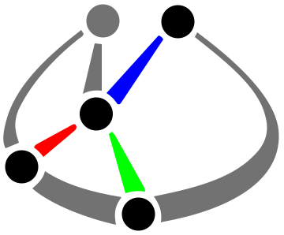

# spatial-casadi

Differentiable rotations and rigid transforms for CasADi: one C++ core,
a SciPy-style Python API, and support for `DM`, `SX`, and `MX`.

```bash
pip install spatial-casadi
# or
uv add spatial-casadi
```

```python
import casadi as cs
from spatial_casadi import Rotation

x = cs.SX.sym("x", 3)
r = Rotation.from_rotvec(x)
f = cs.Function("rotation", [x], [r.as_matrix()])
```

[Documentation](https://cmower.github.io/spatial-casadi/) ·
[C++ installation](docs/installation.rst) ·
[Issues](https://github.com/cmower/spatial-casadi/issues) ·
[Citation](CITATION.cff)

For development: `uv sync`, then `uv run pytest` (C++17 compiler required).
See [development instructions](docs/development.rst) for native tests and docs.

## Release notes

**2.0.0 — unreleased**

- Shared C++ core, Python bindings, CMake packaging, and pip/uv wheel builds.
- `RigidTransform`, `Slerp`, batches, indexing, broadcasting, and more SciPy-style operations.
- Fixed identity derivatives, symbolic matrix conversion, and Euler gimbal-lock cases; added derivative and generated-code tests.
- Simpler documentation and a scalable SVG logo. Removed `deg2rad`/`rad2deg`; legacy spatial classes remain.

See [compatibility and migration](docs/compatibility.rst) for supported features,
CasADi batch layouts, and intentional differences from SciPy.

| Previous version | Changes |
| --- | --- |
| 1.1.0 | Fixed rotation-vector conversion; added `Transformation.flatten()`. |
| 1.0.4 | Added symbolic constructors. |
| 1.0.3 | Added scalar-first and scalar-last quaternion formats. |
| 1.0.1–1.0.2 | Packaging, documentation, and project-link updates. |
| 1.0.0 | Initial Python rotations, translations, and transformations. |
